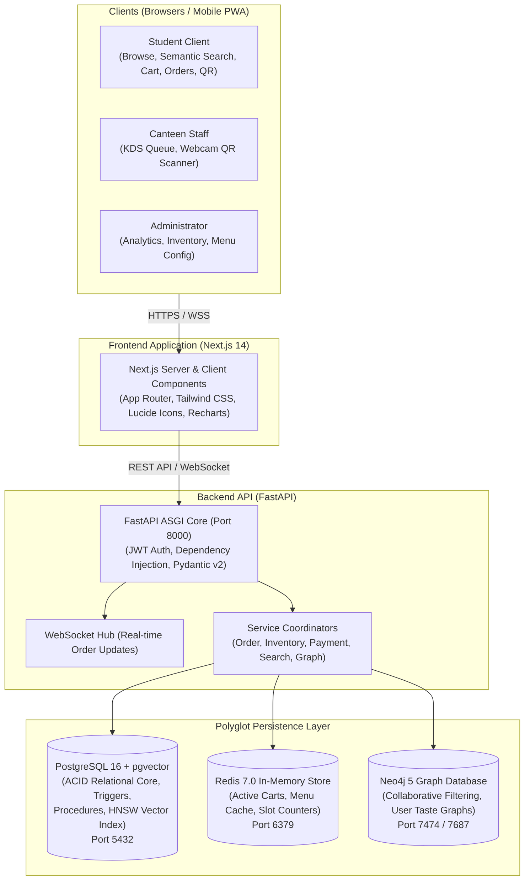

# 🍽️ CampusEats — Smart Campus Canteen Management System

[](https://www.postgresql.org/)
[](https://fastapi.tiangolo.com/)
[](https://nextjs.org/)
[](https://redis.io/)
[](https://neo4j.com/)
[](LICENSE)

> A modern, academic-grade, full-stack college canteen pre-ordering, inventory tracking, and analytics platform powered by a polyglot persistence architecture: **PostgreSQL 16 (pgvector) + Redis 7 + Neo4j 5 + FastAPI + Next.js 14**.

---

## 📌 Table of Contents

- [Overview](#-overview)
- [System Architecture](#-system-architecture)
- [Technology Stack](#-technology-stack)
- [Comprehensive DBMS Concepts Implemented](#-comprehensive-dbms-concepts-implemented)
- [Project Directory Structure](#-project-directory-structure)
- [Quick Start Guide](#-quick-start-guide)
- [Application Modules & Roles](#-application-modules--roles)
- [API Overview](#-api-overview)
- [UI Screenshots](#-ui-screenshots)
- [Documentation Index](#-documentation-index)
- [License & Contributors](#-license--contributors)

---

## 🌟 Overview

University and college canteens suffer from severe congestion during short class breaks, resulting in chaotic queues, food waste from inaccurate demand forecasting, and lost student time. **CampusEats** resolves these operational challenges through:

1. **Staggered Pickup Scheduling**: Eliminates counter stampedes by bounding capacity in staggered 15-minute pickup slots.
2. **Instant QR Code Verification**: Staff scan encrypted dynamic QR tokens to dispatch orders in seconds.
3. **Automated Recipe-Based Inventory**: Orders atomically deplete raw ingredient stocks via database triggers and Bill of Materials (BOM) recipes.
4. **Natural Language Semantic Search**: High-dimensional vector embeddings (`all-MiniLM-L6-v2`) enable students to search naturally (e.g., *"crispy warm breakfast under ₹100"*).
5. **Graph Recommendation Engine**: Neo4j collaborative filtering suggests dishes based on peer student consumption patterns.

---

## 🏗️ System Architecture



For detailed component interaction and sequence diagrams, refer to [`docs/architecture.md`](file:///home/myth/Documents/5thSem/Mini_Projects/DBMS/CampusEats/docs/architecture.md).

---

## 💻 Technology Stack

| Layer | Technology | Version | Purpose |
|:---|:---|:---:|:---|
| **Relational Database** | [PostgreSQL](https://www.postgresql.org/) | 16.x | ACID transactional core, constraints, triggers, procedures, views |
| **Vector Extension** | [pgvector](https://github.com/pgvector/pgvector) | 0.7.4 | Storing 384-dim embeddings & HNSW Approximate Nearest Neighbor search |
| **Cache & Sessions** | [Redis](https://redis.io/) | 7.0-alpine | Ephemeral shopping carts, slot counters, and menu response caching |
| **Graph Database** | [Neo4j](https://neo4j.com/) | 5.x-community | Social taste graph, peer-to-peer collaborative filtering |
| **Backend Framework** | [FastAPI](https://fastapi.tiangolo.com/) | 0.104+ | High-performance Python ASGI backend, asynchronous I/O |
| **ORM / Data Access** | [SQLAlchemy](https://www.sqlalchemy.org/) + [AsyncPG](https://github.com/MagicStack/asyncpg) | 2.0+ / 0.29+ | Asynchronous database toolkit and object-relational mapper |
| **Database Migrations**| [Alembic](https://alembic.sqlalchemy.org/) | 1.13+ | Schema revision tracking and programmatic migrations |
| **Frontend Framework** | [Next.js](https://nextjs.org/) | 14.x (App Router)| React 18 SSR, TypeScript, dynamic client routing |
| **Styling** | [Tailwind CSS](https://tailwindcss.com/) | 3.4+ | Utility-first responsive design system |
| **Charts & QR** | [Recharts](https://recharts.org/) / [html5-qrcode](https://github.com/mebjas/html5-qrcode) | 2.10+ / 2.3+ | Data visualization and client-side webcam QR scanning |
| **ML Embeddings** | [Sentence-Transformers](https://www.sbert.net/) | 2.2.2 | `all-MiniLM-L6-v2` dense semantic text embeddings |
| **Payment Gateway** | [Razorpay](https://razorpay.com/) | 1.4+ | Test gateway checkout and cryptographic signature verification |

---

## 🎓 Comprehensive DBMS Concepts Implemented

CampusEats is specifically designed to demonstrate mastery over the entire academic **Database Management Systems** syllabus:

- **Entity-Relationship (ER) Modeling**: 11 distinct entities with formal cardinalities and reduction rules. ([`database/docs/er_diagram.md`](file:///home/myth/Documents/5thSem/Mini_Projects/DBMS/CampusEats/database/docs/er_diagram.md))
- **Relational Algebra**: Selection ($\sigma$), Projection ($\pi$), Set Difference ($-$), Joins ($\bowtie$), Division ($\div$), Aggregations ($\mathcal{G}$). ([`database/docs/relational_algebra.md`](file:///home/myth/Documents/5thSem/Mini_Projects/DBMS/CampusEats/database/docs/relational_algebra.md))
- **Formal Normalization (1NF $\rightarrow$ 5NF)**: Functional dependency closures ($X^+$), Armstrong's axioms, candidate keys, and anomaly elimination. ([`database/docs/normalization.md`](file:///home/myth/Documents/5thSem/Mini_Projects/DBMS/CampusEats/database/docs/normalization.md))
- **Query Optimization & EXPLAIN Plans**: Cost formulas, sequential scans vs. index scans, join algorithms, and B-Tree prefix rules. ([`database/docs/query_optimization.md`](file:///home/myth/Documents/5thSem/Mini_Projects/DBMS/CampusEats/database/docs/query_optimization.md))
- **Procedural SQL (PL/pgSQL)**:
  - Stored Functions (`fn_calculate_order_total`, `fn_check_ingredient_availability`)
  - Stored Procedures (`sp_process_order` with `SELECT ... FOR UPDATE` row locking)
  - Active Triggers (`trg_validate_order_status`, `trg_notify_low_stock`)
- **Advanced SQL**: Window functions (`RANK()`, `DENSE_RANK()`), recursive/analytic CTEs, Materialized Views, and Trigram GIN indexing.
- **Modern NoSQL Paradigms**:
  - Key-Value Cache ([Redis Guide](file:///home/myth/Documents/5thSem/Mini_Projects/DBMS/CampusEats/docs/redis_guide.md))
  - Graph Database ([Neo4j Guide](file:///home/myth/Documents/5thSem/Mini_Projects/DBMS/CampusEats/docs/neo4j_guide.md))
  - Vector Embeddings ([pgvector Guide](file:///home/myth/Documents/5thSem/Mini_Projects/DBMS/CampusEats/docs/pgvector_guide.md))

Full curriculum mapping available in [`docs/dbms_syllabus_mapping.md`](file:///home/myth/Documents/5thSem/Mini_Projects/DBMS/CampusEats/docs/dbms_syllabus_mapping.md).

---

## 📁 Project Directory Structure

```text
CampusEats/
├── docker-compose.yml              # PostgreSQL (pgvector), Redis, and Neo4j services
├── .env.example                    # Global environment variable template
├── README.md                       # This master document
│
├── database/                       # Database engineering assets
│   ├── docs/                       # Formal academic DBMS theoretical documents
│   │   ├── er_diagram.md           # Complete Mermaid ER diagram & 11 entity specifications
│   │   ├── relational_schema.md    # Formal relational schema notation & conversion rules
│   │   ├── normalization.md        # 1NF through 5NF decomposition, closures, Armstrong's axioms
│   │   ├── relational_algebra.md   # RA expressions mapped 1-to-1 with SQL queries
│   │   └── query_optimization.md   # PostgreSQL query planner, cost models, and indexing
│   ├── sql/                        # Production PostgreSQL 16 DDL & DML scripts
│   │   ├── schema.sql              # Table definitions, constraints, UUIDs, pgvector
│   │   ├── sample_data.sql         # Rich sample data (Indian canteen context)
│   │   ├── indexes.sql             # B-Tree, Composite, Partial, GIN, HNSW indexes
│   │   ├── triggers.sql            # Automated state machine & audit triggers
│   │   ├── functions.sql           # Stored functions for business calculations
│   │   ├── procedures.sql          # ACID order processing with pessimistic locking
│   │   ├── views.sql               # Logical and materialized views for reporting
│   │   ├── advanced_queries.sql    # Window functions, CTEs, joins, and set operations
│   │   ├── optimization.sql        # EXPLAIN ANALYZE demonstration scripts
│   │   └── full_text_search.sql    # PostgreSQL full-text and trigram fuzzy search
│   └── neo4j/                      # Graph database scripts (Cypher)
│       ├── schema.cypher           # Uniqueness constraints and secondary indexes
│       ├── sample_data.cypher      # Graph seed data (Students, Dishes, Orders)
│       └── queries.cypher          # Recommendation engine & collaborative filtering
│
├── backend/                        # FastAPI Asynchronous REST & WebSocket Backend
│   ├── requirements.txt            # Python dependencies
│   ├── pyproject.toml              # Pytest & package build configuration
│   ├── alembic.ini                 # Alembic migration configuration
│   └── app/
│       ├── main.py                 # FastAPI application factory & lifespan handler
│       ├── config.py               # Pydantic v2 application settings
│       ├── database.py             # SQLAlchemy Async Engine & Sessionmaker
│       ├── dependencies.py         # JWT authentication & RBAC dependency injection
│       ├── models/                 # SQLAlchemy 2.0 ORM model definitions
│       ├── schemas/                # Pydantic request/response validation schemas
│       ├── services/               # Core business logic (Order, Cart, Payment, Search)
│       └── api/                    # Modular API route controllers
│
├── frontend/                       # Next.js 14 App Router Web Application
│   ├── package.json                # Node.js dependencies
│   ├── tsconfig.json               # TypeScript configuration
│   ├── tailwind.config.ts          # Tailwind CSS styling tokens
│   └── src/                        # Next.js pages, components, contexts, and hooks
│
└── docs/                           # Comprehensive System Documentation
    ├── architecture.md             # System architecture & Mermaid sequence flows
    ├── setup_fedora.md             # Step-by-step setup guide for Fedora Linux
    ├── api_reference.md            # Detailed REST & WebSocket API documentation
    ├── database_guide.md           # PostgreSQL container management & psql operations
    ├── redis_guide.md              # Redis caching strategies, key TTLs, and monitoring
    ├── neo4j_guide.md              # Graph modeling & collaborative filtering guide
    ├── pgvector_guide.md           # Semantic vector search & sentence-transformers
    ├── dbms_syllabus_mapping.md    # Unit-by-unit university DBMS curriculum mapping
    ├── sql_demo_guide.md           # Viva presentation and lab examination demo guide
    ├── testing_guide.md            # Backend pytest & frontend manual testing instructions
    └── troubleshooting.md          # Diagnostic runbook for common errors
```

---

## 🚀 Quick Start Guide

For complete, step-by-step Fedora Linux instructions, read [`docs/setup_fedora.md`](file:///home/myth/Documents/5thSem/Mini_Projects/DBMS/CampusEats/docs/setup_fedora.md).

### 1. Launch Database Containers
```bash
docker compose up -d
```

### 2. Initialize Database Schema & Seed Data
```bash
docker exec -i campuseats-postgres psql -U campuseats -d campuseats_db < database/sql/schema.sql
docker exec -i campuseats-postgres psql -U campuseats -d campuseats_db < database/sql/sample_data.sql
docker exec -i campuseats-postgres psql -U campuseats -d campuseats_db < database/sql/indexes.sql
docker exec -i campuseats-postgres psql -U campuseats -d campuseats_db < database/sql/triggers.sql
docker exec -i campuseats-postgres psql -U campuseats -d campuseats_db < database/sql/functions.sql
docker exec -i campuseats-postgres psql -U campuseats -d campuseats_db < database/sql/procedures.sql
docker exec -i campuseats-postgres psql -U campuseats -d campuseats_db < database/sql/views.sql
docker exec -i campuseats-postgres psql -U campuseats -d campuseats_db < database/sql/full_text_search.sql
```

### 3. Start Backend Server
```bash
cd backend
python3.11 -m venv venv
source venv/bin/activate
pip install -r requirements.txt
cp .env.example .env
uvicorn app.main:app --host 0.0.0.0 --port 8000 --reload
```
Interactive API Docs: `http://localhost:8000/docs`

### 4. Start Frontend Application
```bash
cd frontend
cp .env.local.example .env.local
npm install
npm run dev
```
Access Web Application: `http://localhost:3000`

---

## 👥 Application Modules & Roles

| Role | Access URL | Default Credentials | Core Capabilities |
|:---|:---|:---|:---|
| **Student** | `/menu`, `/cart`, `/orders` | `student@campus.edu` / `student123` | Browsing menu, dietary filtering, natural language search, cart management, slot selection, order QR display |
| **Kitchen Staff** | `/staff/orders`, `/staff/scan` | `staff@campus.edu` / `staff123` | Real-time Kitchen Order Display (KDS), updating prep states, webcam QR verification counter |
| **Administrator** | `/admin`, `/admin/inventory` | `admin@campus.edu` / `admin123` | Executive sales dashboards, demand forecasting, stock restock logging, Neo4j graph sync |

---

## 📡 API Overview

The backend exposes over 35 REST endpoints categorized by domain:

- **Auth** (`/api/auth`): Registration, login, JWT token refresh.
- **Food** (`/api/food`): Categories and food catalog management with dietary filters.
- **Cart** (`/api/cart`): High-speed Redis-backed shopping cart operations.
- **Orders** (`/api/orders`): Order creation, cancellation, and history retrieval.
- **Staff** (`/api/staff`): Kitchen queue and lifecycle state updates.
- **Pickup Slots** (`/api/pickup-slots`): Capacity management and scheduling windows.
- **Payments** (`/api/payments`): Razorpay order generation and HMAC signature verification.
- **QR** (`/api/qr`): Base64 QR code generation and dispatch scanning.
- **Inventory** (`/api/inventory`): Raw ingredient balances, restock logs, and low-stock alerts.
- **Search** (`/api/search`): Natural language vector search and fuzzy trigram matching.
- **Graph** (`/api/graph`): Personalized recommendations via Neo4j.
- **WebSocket** (`/api/ws`): Full-duplex real-time order status broadcasts.

Refer to [`docs/api_reference.md`](file:///home/myth/Documents/5thSem/Mini_Projects/DBMS/CampusEats/docs/api_reference.md) for full request/response payloads.

---

## 📸 UI Screenshots

*Screenshots from live application:*

| Student Menu & Cart | Kitchen Display System (KDS) |
|:---:|:---:|
| *(Interactive Menu with Dietary Badges & Cart Drawer)* | *(Real-time Order Stages & Status Buttons)* |

| QR Code Verification | Admin Analytics & Forecasting |
|:---:|:---:|
| *(Webcam Scanner confirming Student Meal Dispatch)* | *(Sales Revenue Graphs & Low Stock Indicators)* |

---

## 📚 Documentation Index

All project documentation is located in `database/docs/` and `docs/`:

1. [Mermaid Entity-Relationship (ER) Model](file:///home/myth/Documents/5thSem/Mini_Projects/DBMS/CampusEats/database/docs/er_diagram.md)
2. [Formal Relational Schema Notation](file:///home/myth/Documents/5thSem/Mini_Projects/DBMS/CampusEats/database/docs/relational_schema.md)
3. [Normalization Study (1NF - 5NF)](file:///home/myth/Documents/5thSem/Mini_Projects/DBMS/CampusEats/database/docs/normalization.md)
4. [Relational Algebra to SQL Mapping](file:///home/myth/Documents/5thSem/Mini_Projects/DBMS/CampusEats/database/docs/relational_algebra.md)
5. [Query Optimization & EXPLAIN Guide](file:///home/myth/Documents/5thSem/Mini_Projects/DBMS/CampusEats/database/docs/query_optimization.md)
6. [System Architecture & Sequence Flows](file:///home/myth/Documents/5thSem/Mini_Projects/DBMS/CampusEats/docs/architecture.md)
7. [Fedora Linux Complete Setup Guide](file:///home/myth/Documents/5thSem/Mini_Projects/DBMS/CampusEats/docs/setup_fedora.md)
8. [REST & WebSocket API Reference](file:///home/myth/Documents/5thSem/Mini_Projects/DBMS/CampusEats/docs/api_reference.md)
9. [Database Operations & psql Guide](file:///home/myth/Documents/5thSem/Mini_Projects/DBMS/CampusEats/docs/database_guide.md)
10. [Redis In-Memory Caching Guide](file:///home/myth/Documents/5thSem/Mini_Projects/DBMS/CampusEats/docs/redis_guide.md)
11. [Neo4j Graph Database Guide](file:///home/myth/Documents/5thSem/Mini_Projects/DBMS/CampusEats/docs/neo4j_guide.md)
12. [pgvector & Neural Search Guide](file:///home/myth/Documents/5thSem/Mini_Projects/DBMS/CampusEats/docs/pgvector_guide.md)
13. [Academic DBMS Syllabus Mapping](file:///home/myth/Documents/5thSem/Mini_Projects/DBMS/CampusEats/docs/dbms_syllabus_mapping.md)
14. [SQL Practical Demo & Viva Guide](file:///home/myth/Documents/5thSem/Mini_Projects/DBMS/CampusEats/docs/sql_demo_guide.md)
15. [Testing & Quality Assurance Guide](file:///home/myth/Documents/5thSem/Mini_Projects/DBMS/CampusEats/docs/testing_guide.md)
16. [Troubleshooting & Diagnostics Runbook](file:///home/myth/Documents/5thSem/Mini_Projects/DBMS/CampusEats/docs/troubleshooting.md)

---

## 📄 License & Contributors

Distributed under the **MIT License**. See `LICENSE` for details.

Developed for **5th Semester DBMS Mini-Project Evaluation**.  
*CampusEats Development Team — 2026.*
