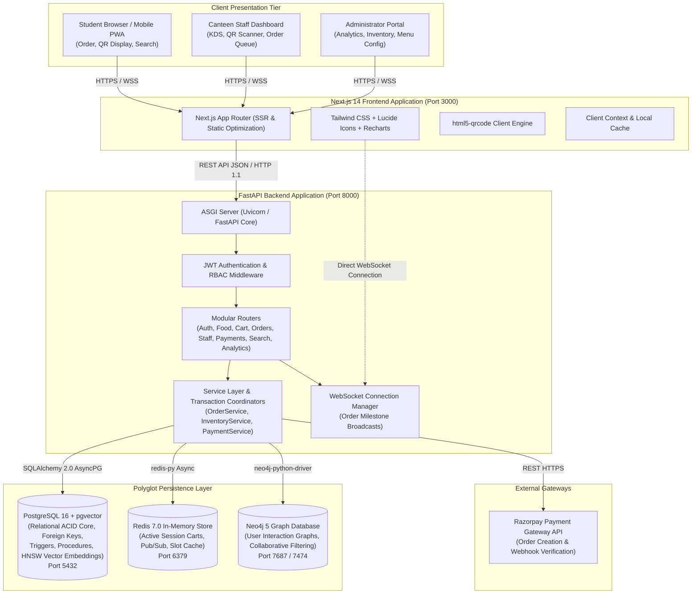
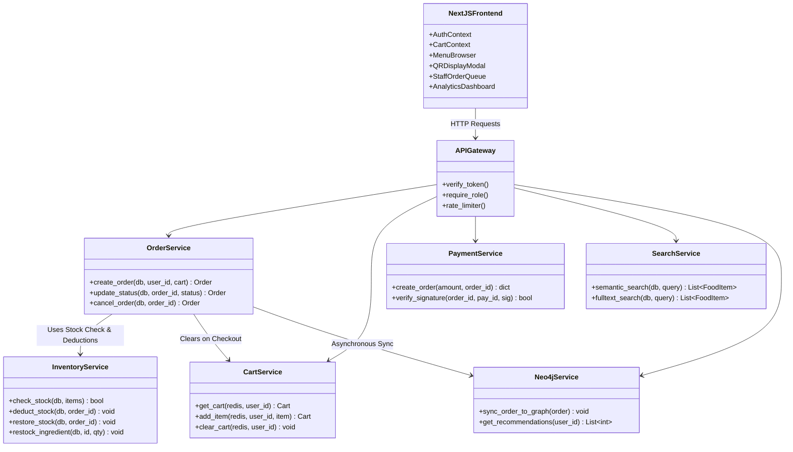
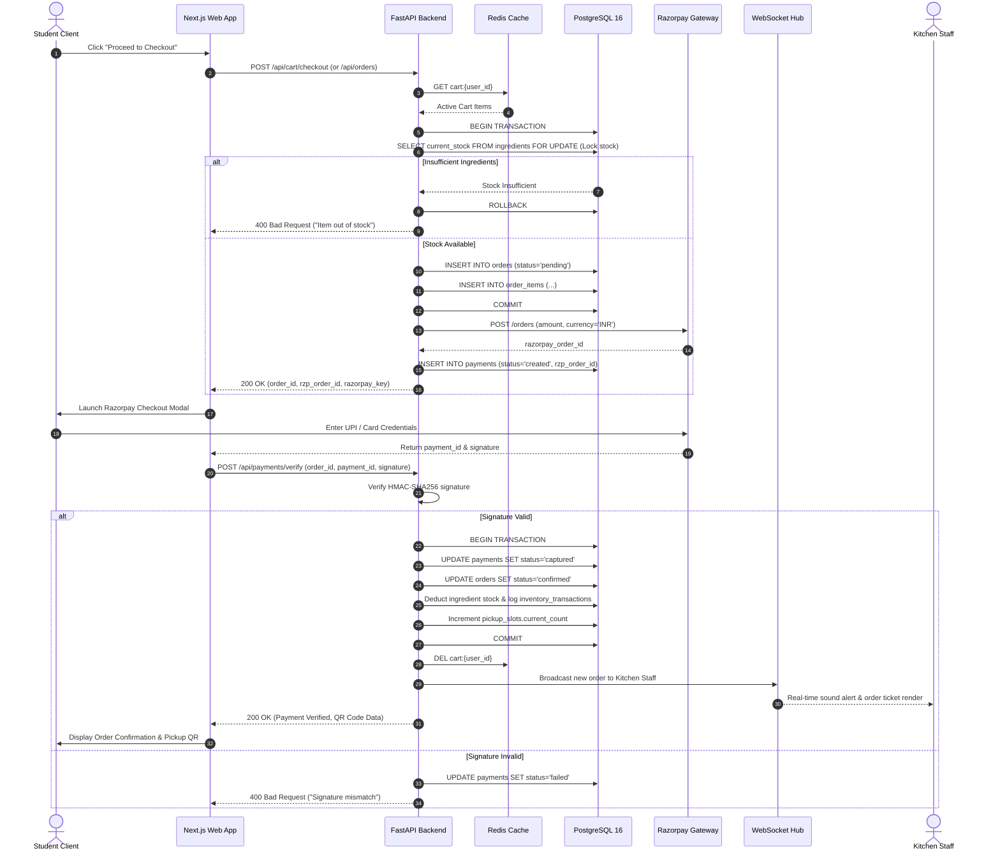
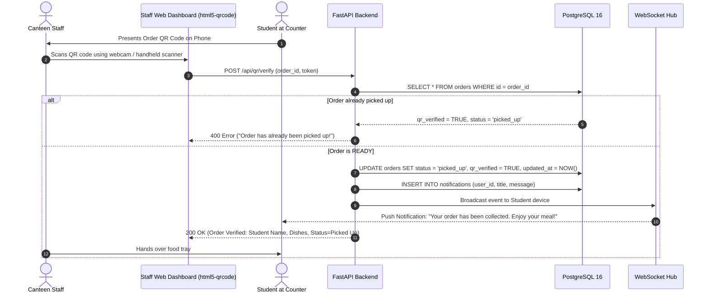
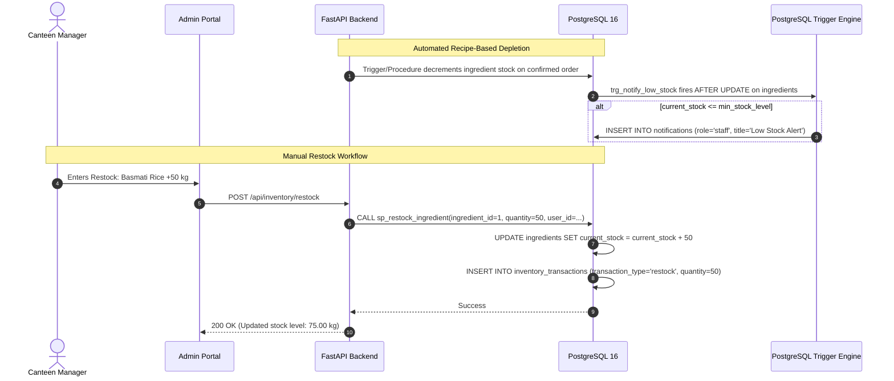
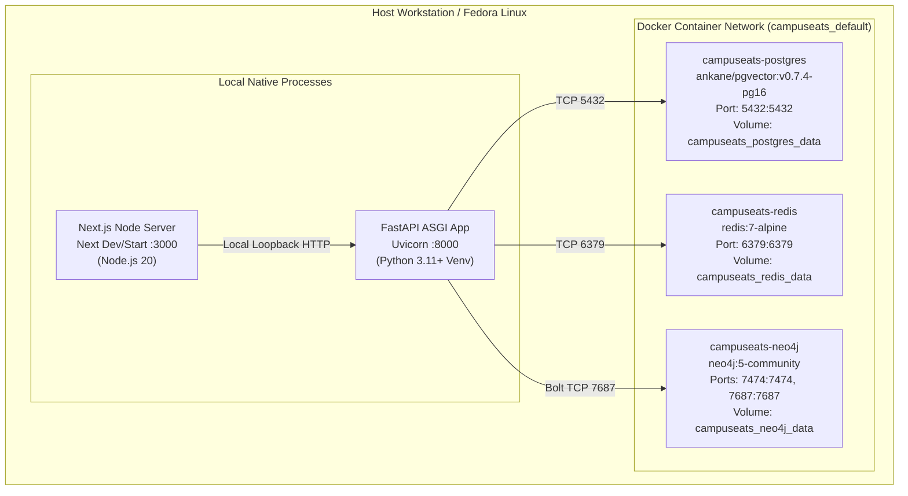

# CampusEats — System Architecture & Data Flow

This document details the multi-tier software architecture of the **CampusEats** platform. It provides high-level topological maps, component interactions, runtime deployment configurations, and end-to-end data flow specifications for core transactional workflows (ordering, payment settlement, and inventory deduction).

---

## 1. High-Level System Architecture

CampusEats follows a modern decoupled, multi-tier micro-monolith architecture designed for high concurrency, low latency, and ACID-compliant transaction safety.

---

## 2. Component Diagram

The following diagram illustrates internal modular components within the backend and frontend systems and their explicit dependency boundaries:

---

## 3. Core Transactional Data Flows

### 3.1 End-to-End Order Placement & Payment Flow

---

### 3.2 Kitchen Dispatch & QR Code Verification Flow

---

### 3.3 Inventory Depletion & Restock Flow

---

## 4. Physical Deployment Architecture

CampusEats is architected for containerized deployment on Linux/Fedora workstations and production Kubernetes/Docker environments:

---

## 5. Security & Isolation Architecture

1. **Authentication**: Stateless HMAC-SHA256 JSON Web Tokens (JWT) issued with 30-minute access expiration and 7-day refresh tokens.
2. **Authorization**: Strict Role-Based Access Control (RBAC) enforced via FastAPI dependency injection:
   - `student`: Can view active menu, manage personal cart, book orders, view personal QR.
   - `staff`: Can view kitchen queue, verify QR codes, modify order states, view ingredient stock.
   - `admin`: Can modify categories, alter item prices, trigger restock, access financial reports, inspect user graph.
3. **Database Concurrency Isolation**: Explicit row-level pessimistic locking (`SELECT ... FOR UPDATE`) prevents race conditions and overselling during simultaneous checkout of limited ingredients and pickup slots.
