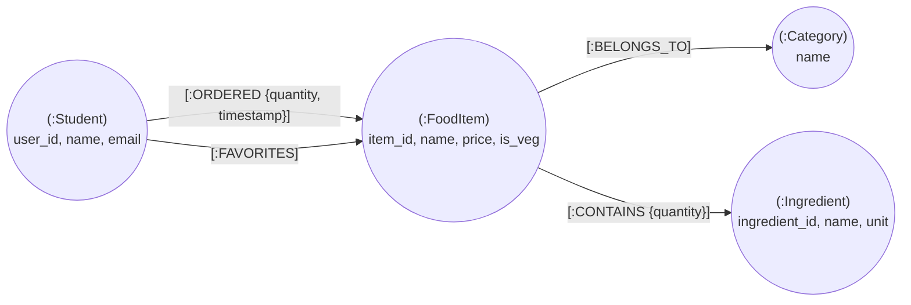

# CampusEats — Neo4j Graph Database Guide

This guide details the integration and usage of **Neo4j 5 Community Edition** in **CampusEats**. It explores graph data modeling, index-free adjacency, collaborative filtering recommendation algorithms, the Neo4j Browser interface, and comparative trade-offs against relational databases.

---

## 1. Why a Graph Database in CampusEats?

While PostgreSQL excels at ACID relational transactions, graph databases like Neo4j excel at exploring **highly connected networks of relationships**:

| Analytical Capability | Relational DB (PostgreSQL) | Graph DB (Neo4j) |
|:---|:---|:---|
| **Storage Architecture** | Tables with Foreign Key constraints | Native Property Graph with Pointers |
| **Traversal Cost** | $O(\log N)$ B-Tree index lookups per join step ($N \Join M \Join K$) | $O(1)$ constant-time pointer chasing (**Index-Free Adjacency**) |
| **Multi-Hop Traversal** | Deep `JOIN` operations or recursive CTEs; memory-intensive | Natural pattern matching in Cypher: `(a)-[:REL*1..3]->(b)` |
| **Recommendation Engine** | Cartesian self-joins over orders and order items; slow under scale | Direct collaborative filtering and community detection |
| **Dietary Allergen Impact** | Recursive SQL query across `recipes` and `ingredients` | Graph neighborhood subgraphs: `(Dish)-[:CONTAINS]->(Ingredient)` |

---

## 2. Graph Data Model

The CampusEats graph consists of **4 Node Labels** and **4 Relationship Types**:



### 2.1 Node Properties
1. **`(:Student)`**:
   - `user_id` (`String`, Unique): Matches PostgreSQL `users.id` (UUID).
   - `name` (`String`): Student's full name.
   - `email` (`String`): Campus email.
2. **`(:FoodItem)`**:
   - `item_id` (`Integer`, Unique): Matches PostgreSQL `food_items.id`.
   - `name` (`String`): Dish title.
   - `price` (`Float`): Dish price in INR.
   - `is_vegetarian` (`Boolean`): Dietary indicator.
3. **`(:Category)`**:
   - `name` (`String`, Unique): E.g., "South Indian", "North Indian", "Beverages".
4. **`(:Ingredient)`**:
   - `ingredient_id` (`Integer`, Unique): Matches PostgreSQL `ingredients.id`.
   - `name` (`String`): Raw material name.
   - `unit` (`String`): Unit of measurement.

### 2.2 Relationship Types
- `(:Student)-[:ORDERED {quantity: int, timestamp: datetime}]->(:FoodItem)`
- `(:Student)-[:FAVORITES]->(:FoodItem)`
- `(:FoodItem)-[:BELONGS_TO]->(:Category)`
- `(:FoodItem)-[:CONTAINS {quantity_required: float}]->(:Ingredient)`

---

## 3. Starting Neo4j & Accessing the Browser

The Neo4j container is defined in `docker-compose.yml`:
- **HTTP Web Browser**: `http://localhost:7474`
- **Bolt Binary Protocol**: `bolt://localhost:7687`
- **Default Username**: `neo4j`
- **Default Password**: `campuseats_neo4j`

To start Neo4j:
```bash
cd /home/myth/Documents/5thSem/Mini_Projects/DBMS/CampusEats
docker compose up -d neo4j
```

Open your web browser and navigate to: **`http://localhost:7474`**
- Set Connect URL: `bolt://localhost:7687`
- Authentication: Username/Password (`neo4j` / `campuseats_neo4j`)
- Click **Connect**.

---

## 4. Running Schema & Seed Scripts

Execute the Cypher DDL and sample graph data from your terminal:

```bash
cd /home/myth/Documents/5thSem/Mini_Projects/DBMS/CampusEats

# 1. Apply schema constraints and indexes
docker exec -i campuseats-neo4j cypher-shell -u neo4j -p campuseats_neo4j < database/neo4j/schema.cypher

# 2. Load sample nodes and relationships
docker exec -i campuseats-neo4j cypher-shell -u neo4j -p campuseats_neo4j < database/neo4j/sample_data.cypher
```

---

## 5. Key Cypher Query Demonstrations

You can execute these Cypher queries directly inside the Neo4j Browser editor:

### 5.1 Visualize the Complete Graph
```cypher
MATCH (n) OPTIONAL MATCH (n)-[r]->(m)
RETURN n, r, m
LIMIT 100;
```

### 5.2 Collaborative Filtering Recommendation (Students Also Ordered)
Find items ordered by students who bought similar dishes to student "Aarav Patel", excluding items Aarav has already tried:
```cypher
MATCH (s1:Student {name: 'Aarav Patel'})-[:ORDERED]->(shared:FoodItem)<-[:ORDERED]-(s2:Student)
WHERE s1 <> s2
MATCH (s2)-[:ORDERED]->(recommended:FoodItem)
WHERE NOT (s1)-[:ORDERED]->(recommended)
RETURN recommended.name AS recommended_dish,
       recommended.price AS price,
       count(DISTINCT s2) AS frequency,
       collect(DISTINCT s2.name) AS ordered_by_peers
ORDER BY frequency DESC, recommended.price ASC
LIMIT 5;
```

### 5.3 Co-Occurrence Network (Ingredients Frequently Used Together)
Identify ingredients that frequently co-exist across canteen recipes (diamond graph traversal):
```cypher
MATCH (i1:Ingredient)<-[:CONTAINS]-(f:FoodItem)-[:CONTAINS]->(i2:Ingredient)
WHERE id(i1) < id(i2)
RETURN i1.name AS ingredient_a,
       i2.name AS ingredient_b,
       count(f) AS shared_dishes,
       collect(f.name) AS dishes
ORDER BY shared_dishes DESC
LIMIT 8;
```

### 5.4 Dietary Preference Profiling
Aggregate student meal ordering habits up to the cuisine category level:
```cypher
MATCH (s:Student)-[r:ORDERED]->(f:FoodItem)-[:BELONGS_TO]->(c:Category)
RETURN s.name AS student,
       c.name AS preferred_cuisine,
       sum(r.quantity) AS portions_ordered,
       collect(DISTINCT f.name) AS favorite_dishes
ORDER BY student, portions_ordered DESC;
```

### 5.5 Allergen & Ingredient Impact Traceability
Find all dishes that become unavailable if "Paneer" stock runs out:
```cypher
MATCH (i:Ingredient {name: 'Paneer'})<-[:CONTAINS]-(f:FoodItem)
RETURN f.name AS impacted_dish, f.price AS price;
```

---

## 6. Python Synchronization via `neo4j-python-driver`

The backend service `backend/app/services/neo4j_service.py` connects asynchronously using the official driver:

```python
from neo4j import AsyncGraphDatabase

driver = AsyncGraphDatabase.driver(
    "bolt://localhost:7687", 
    auth=("neo4j", "campuseats_neo4j")
)

async def sync_order(user_id: str, food_item_id: int, quantity: int):
    async with driver.session() as session:
        await session.run(
            """
            MERGE (s:Student {user_id: $user_id})
            MERGE (f:FoodItem {item_id: $item_id})
            CREATE (s)-[:ORDERED {quantity: $qty, timestamp: datetime()}]->(f)
            """,
            user_id=user_id, item_id=food_item_id, qty=quantity
        )
```

To trigger a full sync of historical PostgreSQL orders into Neo4j, call:
```bash
curl -X POST http://localhost:8000/api/graph/sync -H "Authorization: Bearer <admin_token>"
```
